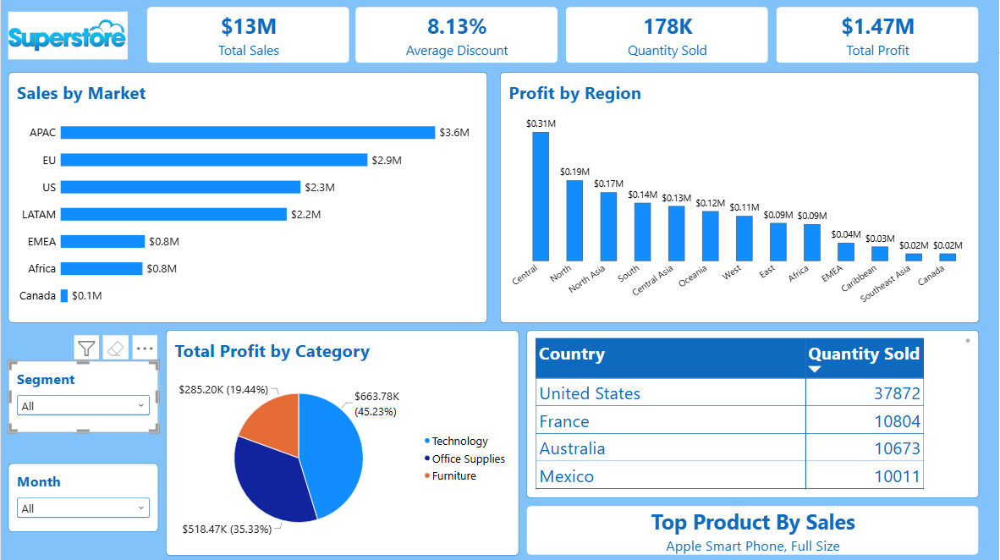

# Superstore-Dashboard — Python Data Cleaning & Power BI Profitability Dashboard

An end-to-end analytics project built with Python and Microsoft Power BI on a
global retail dataset of 51,289 order lines across 147 countries (Jan 2011 –
Dec 2014). The project covers a full data-quality audit in Python, a six-method
outlier comparison, star-schema data modeling, 22 DAX measures, and an
executive dashboard delivering insights on revenue, profitability, discount
behaviour, market coverage, and category performance.

The core question driving the work: of the 29.20% of rows flagged as
statistical outliers, how many are data errors and how many are legitimate
high-value transactions? The answer determined whether the dataset could be
analysed at all.



---

## Dataset Overview

| Attribute | Value |
|---|---|
| Order lines | 51,289 |
| Unique orders | 25,035 |
| Unique customers | 4,873 |
| Period | 1 Jan 2011 – 31 Dec 2014 |
| Gross revenue | $15.01M |
| Net revenue | $12.64M |
| Total discount | $2.36M (15.8% of gross) |
| Total profit | $1.47M |
| Overall profit margin | 11.61% |
| Average order value | $505 |
| Average discount rate | 14.29% |
| Units sold | 178,311 |
| Product categories | 3 |
| Sub categories | 17 |
| Markets | 7 |
| Regions | 13 |
| Countries | 147 |

One row is a **line item within an order**, not an order — 2.05 line items per
order on average. Every transaction count uses `DISTINCTCOUNT` on `Order ID`;
using row count would inflate the figure twofold.

## Project Scope

1. **Data quality audit (Python)** — profiled all 28 columns, removed a
   constant `Record.Count` column, dropped 9 logical duplicates after verifying
   every non-key column matched, removed 1 row with `Sales = 0`, and
   normalised 32 product names containing double spaces via `\s+` regex.
   Corrected 629 `Discount` values carrying a consistent 0.002 offset from
   their standard step, while flagging 2,111 non-standard values as suspected
   regional tiers rather than altering them. Total rows dropped: under 0.1%.
2. **Outlier detection (Python)** — compared six methods: IQR, Z-score,
   Modified Z-score, Isolation Forest, Local Outlier Factor, and Mahalanobis
   distance. Concluded that the 29.20% flagged by IQR are predominantly
   legitimate extremes driven by right-skewed distributions (`Sales` skewness
   8.14), and handled them through transformation and flagging rather than
   deletion.
3. **Data modeling (Power BI)** — flat fact table plus a dedicated `DimTanggal`
   calendar table marked as date table, joined one-to-many on
   `DimTanggal[Date] → superstore_bersih[Order.Date]`, with `Month` sorted by
   its numeric helper column.
4. **DAX measures** — 22 measures covering core metrics, time intelligence
   (previous-year comparison, YTD, rolling average), share and ranking,
   discount analysis, and loss-making transaction checks.
5. **Dashboard** — 4 KPI cards, market and regional breakdowns, category
   profit composition, a country volume table, a dynamic Top Product card,
   and segment/month slicers.

## Key Findings

- Sales grew from $2.26M in 2011 to $4.30M in 2014, a CAGR of 23.9%, with
  profit growing faster than revenue in every year — growth was **not** bought
  with discounts.
- **Discount is the single largest profit lever.** Aggregate margin crosses
  zero between 25% and 30% discount; at 70% the average loss reaches 1.35× the
  sale value. Spearman correlation between `Discount` and per-line margin is
  −0.671.
- The Pareto curve for products **peaks at 137.1%** before falling back to
  100%. Profitable products generate $2.01M, then 2,891 loss-making products
  (28.1% of the catalogue) erode $544K of it. Pruning this group outweighs
  chasing new sales.
- Market coverage is heavily skewed: APAC ($3.59M) and EU ($2.94M) hold 52% of
  revenue, while Canada contributes $66.9K — under 1%. Flagged as a coverage
  question rather than a market signal.
- Only 1 of 17 sub categories loses money in aggregate (`Tables`, −$64.1K at
  −8.47% margin, average discount 29.07%), yet 24.46% of all line items and
  1,058 customers (21.7%) are loss-making. The problem is structural in
  discount policy, not confined to one category.
- Seasonality is pronounced: average December sales ($395K/month) run 2.91×
  the February trough ($136K/month).
- Lead time is **fully determined by `Ship.Mode`** — the ranges do not overlap
  at all (Same Day 0–1 days, First Class 1–3, Second Class 2–5, Standard Class
  4–7). It is not an operational performance metric, and the two fields should
  never both enter a model.

## DAX Measures (22)

| Measure | Formula | Purpose |
|---|---|---|
| Total Sales | `SUM(superstore_bersih[Sales])` | Net revenue after discount |
| Total Gross Sales | `SUMX(superstore_bersih, DIVIDE([Sales], 1 - [Discount]))` | Transaction value before discount |
| Total Discount Value | `[Total Gross Sales] - [Total Sales]` | Absolute discount given, in currency |
| Total Profit | `SUM(superstore_bersih[Profit])` | Total profit across order lines |
| Profit Margin | `DIVIDE([Total Profit], [Total Sales])` | Profit margin on net revenue |
| Quantity Sold | `SUM(superstore_bersih[Quantity])` | Units sold |
| Jumlah Pesanan | `DISTINCTCOUNT(superstore_bersih[Order.ID])` | Unique orders, not line items |
| Jumlah Pelanggan | `DISTINCTCOUNT(superstore_bersih[Customer.ID])` | Unique customers by ID, never by name |
| Avg Order Value | `DIVIDE([Total Sales], [Jumlah Pesanan])` | Average net value per order |
| Avg Profit per Order | `DIVIDE([Total Profit], [Jumlah Pesanan])` | Average profit contribution per order |
| Avg Discount | `AVERAGE(superstore_bersih[Discount])` | Mean discount rate applied per line |
| Discount Rate % | `DIVIDE([Total Discount Value], [Total Gross Sales])` | Discount as a proportion of gross sales |
| Transaksi Merugi | `CALCULATE(COUNTROWS(superstore_bersih), superstore_bersih[Profit] < 0)` | Count of loss-making line items |
| % Transaksi Merugi | `DIVIDE([Transaksi Merugi], COUNTROWS(superstore_bersih))` | Share of transactions sold at a loss |
| PY Sales | `CALCULATE([Total Sales], SAMEPERIODLASTYEAR(DimTanggal[Date]))` | Prior-year sales in the matching period |
| Sales YoY % | `DIVIDE([Total Sales] - [PY Sales], [PY Sales])` | Year-over-year revenue growth |
| Profit YoY % | `DIVIDE([Total Profit] - [PY Profit], [PY Profit])` | Year-over-year profit growth |
| Sales YTD | `TOTALYTD([Total Sales], DimTanggal[Date])` | Cumulative sales from the start of the year |
| Sales 3M Avg | `AVERAGEX(DATESINPERIOD(DimTanggal[Date], MAX(DimTanggal[Date]), -3, MONTH), [Total Sales])` | Three-month rolling average, smooths volatility |
| % of Total Sales | `DIVIDE([Total Sales], CALCULATE([Total Sales], ALLSELECTED(superstore_bersih[Market])))` | Each market's share of total sales |
| Top Product By Sales | `VAR t = TOPN(1, VALUES([Product.Name]), [Total Sales], DESC) RETURN CONCATENATEX(t, [Product.Name], ", ")` | Highest-revenue product, responsive to filters |
| Sub Category Rank | `RANKX(ALLSELECTED(superstore_bersih[Sub.Category]), [Total Profit], , DESC, DENSE)` | Sub-category ranking by profit, used for Top N |

> `CONCATENATEX` guards the Top-N measures against ties: if two products share
> the same revenue, both names are returned comma-separated rather than the
> measure returning blank.

## Dashboard Components

| Section | Visual | Fields |
|---|---|---|
| Filters | Slicer (dropdown) | `Segment`, `DimTanggal[Month]` |
| KPI row | 4 × Card | Total Sales, Avg Discount, Quantity Sold, Total Profit |
| Geography | Clustered bar | `Market` × `[Total Sales]`, sorted descending |
| Geography | Clustered column | `Region` × `[Total Profit]`, sorted descending |
| Composition | Pie | `Category` × `[Total Profit]`, value and percent labels |
| Geography | Table | `Country`, `[Quantity Sold]`, sorted descending |
| Ranking | Card | `[Top Product By Sales]` |

Profit by category is shown as a pie because there are only three slices that
sum to a meaningful whole. At sub-category level (17 items) the same view must
become a horizontal bar chart — a pie stops being readable well before that.

## Repository Structure

```
.
├── data/
│   ├── Global_Superstore.csv          # raw input
│   └── superstore_bersih.csv          # cleaned output of the notebook
├── notebooks/
│   └── cek_noise_outlier.ipynb        # audit, outlier comparison, EDA
├── pbix/
│   └── SuperstoreIQ.pbix
├── docs/
│   ├── measures.md
│   ├── ringkasan_analisis_bisnis.xlsx # 9-sheet summary export
│   └── dashboard.png
└── README.md
```

## How to Reproduce

1. Run `notebooks/cek_noise_outlier.ipynb` end to end. It reads the raw CSV and
   writes `data/superstore_bersih.csv` plus a 9-sheet summary workbook.
2. Open `pbix/SuperstoreIQ.pbix` in Power BI Desktop (May 2024 release or
   later).
3. If the source path breaks, go to Transform data → Data source settings and
   repoint the CSV to your local `data/` folder. **Set the import locale to
   English (United States)** — the CSV uses `.` as the decimal separator, and
   an Indonesian locale will misread `Profit` values.
4. Confirm the model loads correctly: with no filters applied, `Total Sales`
   must read **12,642,905** and `Total Profit` **1,467,458**. Any other figure
   points to a locale or date-parsing issue at import.
5. Verify `DimTanggal` is marked as a date table and the relationship to
   `Order.Date` is active, otherwise all time-intelligence measures return the
   grand total for every period.

## Known Limitations

- It cannot be confirmed from the dataset whether `Shipping.Cost` has already
  been deducted from `Profit` or stands separately. If it has not, every margin
  figure here is optimistic. This needs confirming with the data owner before
  the numbers drive pricing decisions.
- Neither `Product.ID` nor `Product.Name` is a clean product key: 10,292 IDs
  map to 3,788 names, with one name attached to as many as 46 IDs and 457 IDs
  attached to more than one name. IDs appear to be generated per market.
  Product-level analysis is therefore approximate; `Sub.Category` is the most
  reliable aggregation level.
- `Customer.Name` is not unique — 795 names across 4,873 customer IDs, one name
  shared by up to 7 people. All customer analysis uses `Customer.ID`, so the
  top customer shown may differ from other Superstore dashboards that group by
  name.
- `weeknum` matches the ISO week number for only 80% of rows, indicating a
  different week-numbering convention at source. The column is unused; weekly
  analysis is recalculated from `Order.Date`.
- Modified Z-score cannot be applied to `Discount`: the median is 0 and over
  half the values are 0, so MAD is 0 and the calculation falls through to a
  fallback, flagging 22,281 rows (43%). That result is a computational artifact
  and is disregarded.
- The `contamination=0.01` parameter on Isolation Forest was set manually, so
  the resulting 513 rows (exactly 1.00%) is an imposed figure rather than a
  discovery. A genuine threshold would come from the natural break in the score
  distribution.
- All values are in USD as supplied. Since the dataset spans 7 markets, this
  assumes currency conversion was already applied at source; no exchange-rate
  column exists to verify or re-convert.

## Tools

Python (pandas, scikit-learn, scipy, matplotlib) · Power BI Desktop · Power
Query (M) · DAX · star-schema modeling
